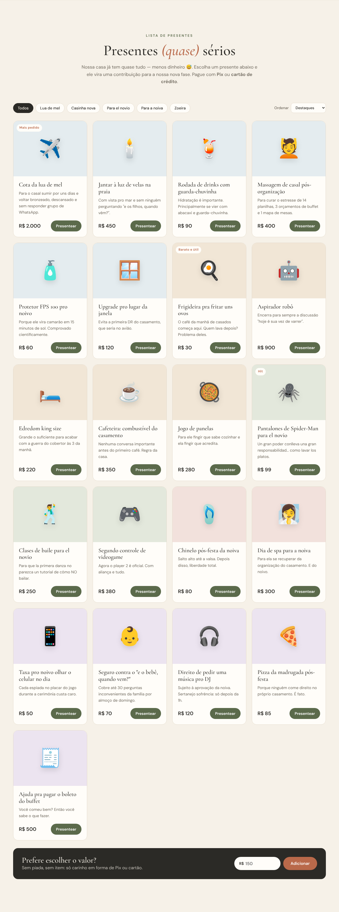

# 💍 Wedding invitation + cash gift registry

A wedding website with an e-commerce-style gift list. Guests "buy" funny gifts (honeymoon quota, a frying pan for eggs, Spider-Man pants for the groom…), but no real product is shipped: **the couple just receives the money**, via:

- **Pix** — a Pix QR code and "copia e cola" code with the exact amount, generated on the fly. Money goes straight to your bank account, no fees, no middleman.
- **Credit card** — via **Stripe Checkout** (hosted, PCI-compliant payment page). Optionally Pix inside Stripe and installments, for Brazilian Stripe accounts.





More screenshots in [`docs/screenshots/`](docs/screenshots), design references in [`docs/inspiration.md`](docs/inspiration.md).

## Run locally

```bash
npm install
cp .env.example .env   # fill in your Pix key and, optionally, Stripe key
npm run dev            # http://localhost:3000
```

```bash
npm test               # Pix BR Code tests (validated against the Banco Central example)
```

## Personalize

| What | Where |
|---|---|
| Names, date, venues, dress code, WhatsApp for RSVPs | `public/config.js` |
| Gift list (titles, jokes, prices, emoji, categories) | `data/gifts.json` |
| Story timeline text | `public/index.html` (`#historia`) |
| Couple photo | add `public/img/casal.jpg` and uncomment the `` in the hero |
| Colors and fonts | CSS variables at the top of `public/styles.css` |

Gift fields: `price` is in reais; `repeatable: true` lets a guest buy several (e.g. honeymoon quotas); `tag` shows a small badge.

## How payments work

- **Prices are computed on the server** from `data/gifts.json`, so a guest can't edit the amount in the browser.
- **Pix** (`POST /api/pix`): builds a static BR Code (EMV) with the total and a reference like `PRESENTE1A2B3C4D`, rendered as an SVG QR code. Static Pix has no automatic confirmation, so after paying the guest is invited to send a WhatsApp note; you see the money in your bank app.
- **Card** (`POST /api/checkout`): creates a Stripe Checkout Session in BRL, with the guest's name and message in the payment metadata (visible in the Stripe Dashboard). After payment the guest lands on `/obrigado`.
- **RSVP** opens WhatsApp with a pre-filled message to the number in `config.js` — no database needed.

### Stripe setup

1. Create an account at [stripe.com](https://stripe.com) (a Brazilian account settles in BRL to a Brazilian bank).
2. Developers → API keys → copy the **secret key** into `STRIPE_SECRET_KEY` (`sk_test_…` to test with card `4242 4242 4242 4242`).
3. Optional: `STRIPE_ENABLE_PIX=true` (Pix inside Stripe is invite-only for Brazilian accounts) and `STRIPE_CARD_INSTALLMENTS=true` for parcelamento.

Card fees are charged by Stripe on each payment; Pix via the built-in QR code is free.

## Deploy

Any Node 20+ host works (Render, Railway, Fly.io…). On Render: New → Web Service → this repo, build `npm install`, start `npm start`, and set the env vars from `.env.example` (plus `PUBLIC_URL`).
