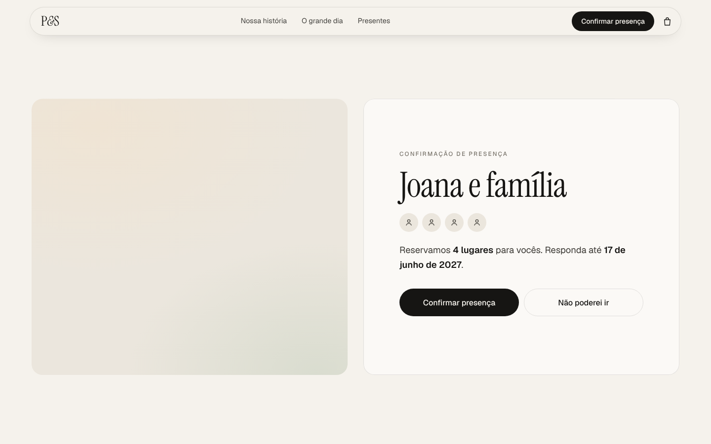
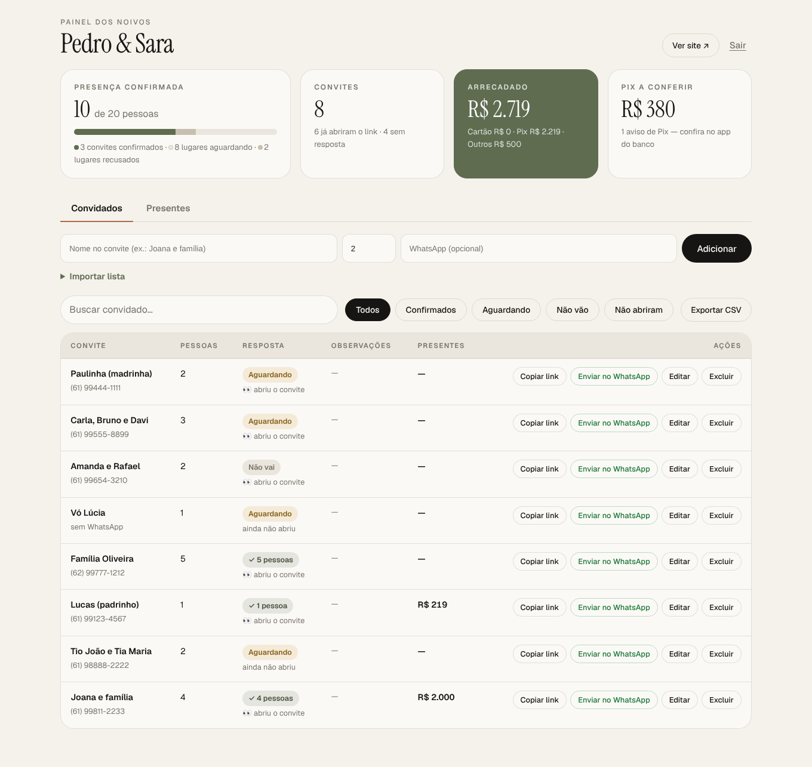

# 💍 Pedro & Sara — 17.07.2027 · Formosa, GO

Wedding website with:

- **Personal invitations, one-tap RSVP**: every invite (e.g. *"Joana e família" — 4 pessoas*) gets its own link, `…/c/<code>`. The guest sees their name and the seats reserved for them, and taps **Confirmar presença** or **Não poderei ir**. No forms, and nobody can add extra people.
- **Gift registry that is really a cash fund**: guests "buy" funny gifts (honeymoon quota, a frying pan for eggs, Spider-Man pants for the groom…) shown with real photos. Nothing is shipped; you get the money via **Pix** (QR code / copia e cola straight to your bank, no fees) or **credit card** (Stripe Checkout).
- **Couple's admin panel** at `/admin`: guest list, who opened their link, who confirmed, and how much money has come in.

| Personal invite | One-tap RSVP | Admin |
|---|---|---|
|  |  |  |

> The screenshots were taken in a sandbox without access to Unsplash, so the photo frames are empty there. On a normal machine or on Render the real photos load.

More in [`docs/screenshots/`](docs/screenshots); design references in [`docs/inspiration.md`](docs/inspiration.md).

## Run locally

```bash
npm install
cp .env.example .env   # set ADMIN_PASSWORD and PIX_KEY at least
npm run images         # downloads the gift photos into public/img/gifts (needs internet)
npm run dev            # site: http://localhost:3000 · admin: http://localhost:3000/admin
```

```bash
npm test
```

Without `DATABASE_URL`, data goes to a local SQLite file (`data/wedding.db`, git-ignored).

## How the couple uses it

1. Open `/admin` and log in with `ADMIN_PASSWORD`.
2. Add invites one by one (name as it should appear, e.g. *Joana e família*, plus the exact number of people), or **Importar lista** to paste many at once: one per line, `Nome; pessoas; telefone` (pasting columns from Google Sheets/Excel also works).
3. For each invite click **Enviar no WhatsApp**: it opens WhatsApp with a ready message and the personal link (or **Copiar link**).
4. Follow along on the dashboard:
   - **Presença confirmada**: confirmed people vs. invited people. Confirming an invite always counts all of its people.
   - **Convites**: how many opened their link and how many haven't answered. The filters show *Confirmados / Aguardando / Não vão / Não abriram*.
   - **Arrecadado**: money received (card + Pix + other), plus how much each invite gave.
   - **Pix a conferir**: guests who clicked "Já fiz o Pix". Check your bank app, then click **Confirmar recebimento**.
5. **Presentes** tab: every gift with name, message and items. Use **Registrar presente** for gifts outside the site (envelope at the party, a direct Pix…).
6. **Exportar CSV** downloads the guest list (for the venue, the buffet, seating…).

You can also edit an invite (seats, phone, notes, or set the answer yourself when someone replies by phone).

## Personalize

| What | Where |
|---|---|
| Names, date, city, venues, dress code, WhatsApp, RSVP deadline | `public/config.js` (venue names/addresses are still placeholders) |
| Gifts: titles, jokes, prices, photos, categories | `data/gifts.json` (`unsplash` = photo id from the Unsplash URL; run `npm run images -- --force` after changing one) |
| Site photos (hero, story, venues, RSVP) | `data/photos.json`, or drop your own photos with the same names into `public/img/site/` (e.g. your real couple photo as `hero.jpg`) |
| Story timeline | `public/index.html` (`#historia`) |
| Colors and fonts | CSS variables at the top of `public/styles.css` |

All photos are free [Unsplash](https://unsplash.com/license) images. `npm run images` (run automatically on deploy) saves resized local copies; any photo not downloaded is served straight from Unsplash, and gift cards fall back to their emoji if even that fails.

## Payments

- **Prices are computed on the server** from `data/gifts.json`, so nobody can change an amount in the browser.
- **Pix**: static BR Code with the exact total and a `PRESENTE…` reference. Static Pix has no automatic confirmation, so the admin panel lists it as *Conferir no banco* until you confirm it.
- **Card**: Stripe Checkout in BRL. Gifts are recorded as received automatically: by the webhook (`/api/stripe/webhook`) and also when the guest reaches the thank-you page.
- Every gift made from a personalized link is attached to that invite.

### Stripe setup

1. Create an account at [stripe.com](https://stripe.com) (a Brazilian account settles in BRL to a Brazilian bank).
2. Developers → API keys → put the **secret key** in `STRIPE_SECRET_KEY` (`sk_test_…` to test with card `4242 4242 4242 4242`).
3. Developers → Webhooks → add endpoint `https://<your-site>/api/stripe/webhook` with events `checkout.session.completed` and `checkout.session.async_payment_succeeded`, and put its signing secret in `STRIPE_WEBHOOK_SECRET`.
4. Optional: `STRIPE_ENABLE_PIX=true` (Pix inside Stripe; invite-only for Brazilian accounts) and `STRIPE_CARD_INSTALLMENTS=true` (parcelamento).

## Deploy (Render + Supabase, both free tiers)

Render's free web services don't keep files between deploys, so production data must live in Postgres:

1. **Supabase**: create a project → Project Settings → Database → copy the *Session pooler* connection string → that's `DATABASE_URL`. Tables are created automatically on first start.
2. **Render**: New → Blueprint → this repo (uses `render.yaml`), then fill `PUBLIC_URL`, `ADMIN_PASSWORD`, `DATABASE_URL`, `PIX_KEY` and the Stripe keys.

The build runs `npm run images`, so the gift photos are downloaded during deploy. Requires Node 22.13+.
